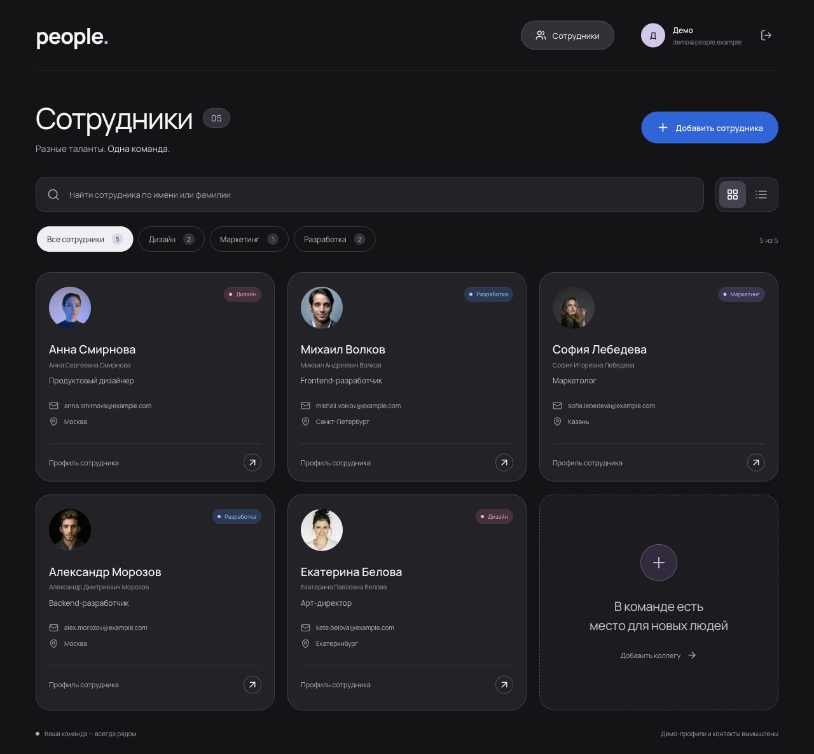

# People — список сотрудников

Каталог команды с регистрацией и входом, поиском по ФИО, фильтрацией по отделам и добавлением сотрудников. Есть карточки, компактный список и подробный профиль. При регистрации создаются пять демонстрационных сотрудников с фотографиями и заполненной информацией.

**[Открыть приложение на Vercel →](https://people-directory-murex.vercel.app/)**



## Стек

- **Клиент:** React 19, TypeScript, Vite, обычный CSS.
- **Сервер:** Node.js 22, Express 5, TypeScript.
- **Данные:** SQLite через `@libsql/client`; на Vercel — Turso.
- **Валидация и тесты:** Zod, Node.js Test Runner, Supertest.

## Локальный запуск

Понадобятся **Node.js 22.13 или новее в ветке 22.x**, npm (поставляется с Node.js) и Git для клонирования.

```sh
git clone https://github.com/Cherepnya-Yaroslav/people-directory.git
cd people-directory
npm ci
npm run dev
```

Откройте [localhost:3000](http://localhost:3000) и создайте аккаунт. Клиент и API запускаются одной командой.

Файл базы `data/people.db` и таблицы создаются автоматически. Данные сохраняются между запусками; у каждого аккаунта свой каталог. Для локальной работы не нужны `.env`, ключи API или внешние сервисы.

Сборка и запуск собранной версии:

```sh
npm run build
npm start
```

Проверки:

```sh
npm run lint
npm run typecheck
npm test
```

## Архитектура

```text
src/       React-интерфейс, формы и клиент API
server/    Express API, авторизация, схема БД и демо-данные
shared/    Общие TypeScript-типы и Zod-схемы
api/       Точка входа Express для Vercel Functions
tests/     Интеграционные тесты API с временной SQLite-базой
```

Клиент обращается к `/api` на том же домене. Сессии хранятся на сервере, токен передаётся в `HttpOnly` cookie; пароли хешируются с помощью `scrypt`. API проверяет авторизацию, принадлежность сотрудников аккаунту и входные данные. Тесты покрывают авторизацию, изоляцию аккаунтов, поиск, фильтры и сохранение данных.

## Развёртывание

На Vercel клиент публикуется как статическая Vite-сборка, а Express работает в Functions. Для постоянного хранения используется Turso: интеграция проекта передаёт `TURSO_DATABASE_URL` и `TURSO_AUTH_TOKEN`. Маршрутизация и команды сборки заданы в [vercel.json](vercel.json). Схема БД создаётся при первом обращении к API.

## Материалы и ИИ

Демо-профили вымышлены. Фотографии, шрифт, иконки и источник Shimmer Skeleton перечислены в [ASSETS.md](ASSETS.md).

В разработке использован **OpenAI Codex (GPT-6)**: разбор требований, проектирование интерфейса по референсу, реализация клиента и сервера, тесты, проверка в браузере и настройка публикации.
